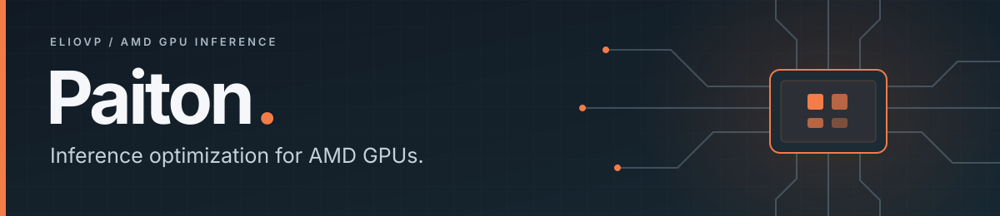
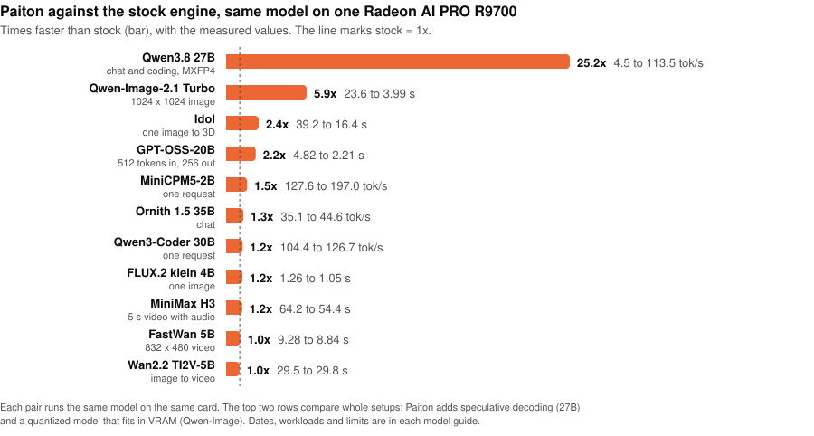

<p align="center"></p>

# Paiton

**Paiton makes local AI models run fast on the AMD Radeon AI PRO R9700.** Qwen3.8 27B answers at about 180 tokens per
second on one 32 GB card, with up to 262,144 tokens of context.

Chat and coding models run in regular vLLM with the Paiton plugin and our own GPU kernels, behind an OpenAI-compatible
API. Image, video and 3D models come with an API, a command-line tool or a ComfyUI workflow. Each model has a
Docker launcher.

[](https://github.com/Eliovp-BV/paiton-vllm-plugin/releases/latest)
[](LICENSE)
[](https://huggingface.co/EliovpAI)

[How much faster](#how-much-faster) · [Pick a model](#start-here) · [Quick start](#quick-start) ·
[All models](#models) · [Requirements](#requirements) · [Documentation](#documentation) · [Support](#support)

## How much faster

<p align="center">
  <picture>
    <source media="(prefers-color-scheme: dark)" srcset="assets/speedup-dark.svg">
    
  </picture>
</p>

Every bar compares Paiton with the stock engine for the same model on the same R9700. The gain depends on the model:
large for the language and image models where Paiton replaces most of the compute path, a few percent for the video
models, and none for Wan2.2 image-to-video. The 27B row was measured on 16 September; the current release is faster
(156 tok/s with the same MXFP4 weights, 180 tok/s with the 3-bit weights). Qwen3.8 Flash Next has no bar because its
16-bit original (360 GB) does not fit on two R9700s. Each model's guide has the workload, the date and the limits of
its numbers.

<a id="start-here"></a>

## Pick a model

| You have | You want | Run | You get |
| --- | --- | --- | --- |
| One R9700 | Fast chat and coding | [Qwen3.8 27B](models/Qwen3.8-MXFP4-DFlash2/README.md), 3-bit | about 180 tok/s, 65K tokens per request |
| One R9700 | Coding agents, long documents | [Qwen3.8 27B](models/Qwen3.8-MXFP4-DFlash2/README.md), 3-bit, `--mode long-kv4` | 262K tokens per request, prefix caching, images with `--vision` |
| One R9700 | The most accurate answers | [Qwen3.8 27B](models/Qwen3.8-MXFP4-DFlash2/README.md), MXFP4 | about 156 tok/s, 65K tokens per request |
| Two R9700s | A larger model, fastest | [Qwen3.8 Flash Next](models/Qwen3.8-Flash-Next/README.md), 3-bit | about 259 tok/s, 98K-token window; 128 GB+ of RAM |
| Two R9700s | A larger model, most accurate | [Qwen3.8 Flash Next](models/Qwen3.8-Flash-Next/README.md), 4-bit | the 16-bit model's task scores, about 245 tok/s; 196 GB+ of RAM |
| Two R9700s | Coding agents | [Qwen3.8 Flash Next](models/Qwen3.8-Flash-Next/README.md), 4-bit, `--prefix-caching` | 262K-token window; a repeated 200K-token prompt starts in under 1 s |
| One R9700 | Images, video or 3D | [Image](#image-generation) · [Video](#video-generation) · [3D](#3d-generation) | see the pictures below |

Speeds are for one request at a time; several requests at once add up to more (489 tok/s for eight requests on the 27B
3-bit, 688 tok/s on Flash Next 3-bit). The exact command, downloads and host requirements for each row are in the
model's guide. Prefer a browser? [Paiton Studio](https://github.com/Eliovp-BV/paiton-studio) runs Paiton in a browser
workspace on a Linux host.

<table>
  <tr>
    <td width="33%"></td>
    <td width="33%"></td>
    <td width="33%"></td>
  </tr>
  <tr>
    <td align="center"><a href="models/FLUX.2-klein/README.md">FLUX.2 klein</a>: text to image, about 1 s</td>
    <td align="center"><a href="models/MiniMax-H3/README.md">MiniMax H3</a>: video with stereo audio</td>
    <td align="center"><a href="models/Idol/README.md">Idol</a>: one image to 3D, 16 s</td>
  </tr>
</table>

**Latest release:** 7 November, new 3-bit weights and a new image for Qwen3.8 27B, and session hibernation for Qwen3.8
Flash Next. [Release notes](https://github.com/Eliovp-BV/paiton-vllm-plugin/releases/latest) ·
[earlier announcements](HISTORY.md).

<a id="run-with-a-managed-container"></a><a id="managed-containers"></a><a id="launch-commands"></a>

## Quick start

The shortest way to see Paiton work is **MiniCPM5-2B**, a small chat and coding model that starts with one command
and checks your setup. The Qwen3.8 27B needs two or three downloads first; its [guide](models/Qwen3.8-MXFP4-DFlash2/README.md#set-up)
lists them.
You need Git, Docker, `curl`, internet access for the first setup, and the GPU
requirements above. [Reserve 60 GB of disk space for the first installation](models/MiniCPM5-2B/BENCHMARKS.md),
including the container runtime.

### 1. Start the server

```bash
git clone --depth 1 https://github.com/Eliovp-BV/paiton-vllm-plugin.git
cd paiton-vllm-plugin
PAITON_BIND=127.0.0.1 ./models/MiniCPM5-2B/serve-docker.sh
```

The first launch downloads the container and model weights, then prepares the
runtime. Later launches reuse the cache. Leave this terminal running.

### 2. Send your first request

Open a second terminal. Check that the server is ready:

```bash
curl --fail -i http://127.0.0.1:8036/health
```

Once it returns **HTTP 200**, send a message:

```bash
curl --fail http://127.0.0.1:8036/v1/chat/completions \
  -H 'Content-Type: application/json' \
  -d '{
    "model": "minicpm5-2b",
    "messages": [{"role": "user", "content": "Explain binary search in two sentences."}],
    "max_tokens": 256,
    "temperature": 0
  }'
```

The response contains the model's answer in `choices[0].message.content`.

**Connect a client:** API base URL `http://127.0.0.1:8036/v1` · model `minicpm5-2b`.
This example accepts connections from this machine only. The
[MiniCPM guide](models/MiniCPM5-2B/README.md) covers network access, API keys and terminal chat.

### 3. Stop or choose another model

```bash
docker stop paiton-minicpm5-2b
```

Your downloaded weights and caches are retained. To start again, run
`PAITON_BIND=127.0.0.1 ./models/MiniCPM5-2B/serve-docker.sh` from the repository
folder. For another model, follow its guide below.

## Requirements

| Requirement | What you need |
| --- | --- |
| **GPU** | Radeon AI PRO R9700, 32 GB. Most guides use one card; Flash Next requires two. Other GPUs have not been qualified. |
| **Host** | Linux with a working AMD GPU driver. Check the model guide for any required driver version. |
| **Containers** | Docker with access to `/dev/kfd` and `/dev/dri`. ComfyUI launchers also require Docker Compose. |
| **Memory and storage** | Check your model's guide before downloading. Requirements depend on the model and selected profile. |

The Docker launchers supply each model's inference environment. Keep the GPU
available to the selected model; run one model at a time on a single R9700.

<a id="model-library"></a><a id="reading-the-benchmarks"></a>

## Models

Each guide covers setup, profiles and support limits. Benchmark links include
the tested configuration, performance measurements and quality tradeoffs.

<a id="chat-reasoning-coding-and-visual-understanding"></a>

### Chat, reasoning and coding

These models provide an OpenAI-compatible API through vLLM.

| Model and guide | Main use | Benchmarks |
| --- | --- | --- |
| [Qwen3.8 27B](models/Qwen3.8-MXFP4-DFlash2/README.md) | Chat and coding on one R9700; accuracy, speed and long-conversation profiles | [Results](models/Qwen3.8-MXFP4-DFlash2/README.md#benchmarks) |
| [Qwen3.8 Flash Next](models/Qwen3.8-Flash-Next/README.md) | Chat and coding on two R9700s; 3-bit or 4-bit, with optional image input on supported 4-bit profiles | [Results](models/Qwen3.8-Flash-Next/BENCHMARKS.md) |
| [MiniCPM5-2B](models/MiniCPM5-2B/README.md) | Lightweight chat, coding and tools | [Results](models/MiniCPM5-2B/BENCHMARKS.md) |
| [Qwen3.8 NEO CODER MAX 27B](models/Qwen3.8-NEO-CODER-MAX/README.md) | Coding and visual chat | [Results](models/Qwen3.8-NEO-CODER-MAX/BENCHMARKS.md) |
| [Qwen3-Coder 30B A3B](models/Qwen3-Coder-30B/README.md) | Code generation, review, testing and tools | [Results](models/Qwen3-Coder-30B/BENCHMARKS.md) |
| [GPT-OSS-20B](models/GPT-OSS-20B/README.md) | Reasoning, coding, tools and structured outputs | [Results](models/GPT-OSS-20B/BENCHMARKS.md) |
| [Ornith 1.5 35B A3B](models/Ornith-1.5/README.md) | Chat with optional reasoning | [Results](models/Ornith-1.5/BENCHMARKS.md) |

Earlier release: [Qwen3.8 27B Qronos](models/Qwen3.8/README.md), superseded by the
current Qwen3.8 27B guide above.

### Image generation

| Model and guide | Main use | Benchmarks |
| --- | --- | --- |
| [FLUX.2 klein 4B](models/FLUX.2-klein/README.md) | Text to image through ComfyUI, web or CLI | [Results](models/FLUX.2-klein/BENCHMARKS.md) |
| [Qwen-Image-2.1](models/Qwen-Image-2.1/README.md) | Image generation and editing through an API or CLI | [Results](models/Qwen-Image-2.1/BENCHMARKS.md) |

### 3D generation

| Model and guide | Main use | Benchmarks |
| --- | --- | --- |
| [Idol](models/Idol/README.md) | One image to a 3D Gaussian splat (`.ply`) through a CLI | [Results](models/Idol/BENCHMARKS.md) |

### Video generation

| Model and guide | Main use | Benchmarks |
| --- | --- | --- |
| [FastWan FullAttn 5B](models/FastWan/README.md) | Text to silent video through ComfyUI | [Results](models/Wan2.2/BENCHMARKS.md) |
| [Wan2.2 TI2V-5B](models/Wan2.2/README.md) | Text or image to silent video through ComfyUI | [Results](models/Wan2.2/BENCHMARKS.md) |
| [MiniMax H3](models/MiniMax-H3/README.md) | Video with stereo audio through ComfyUI | [Results](models/MiniMax-H3/BENCHMARKS.md) |

<a id="meeting-recordings"></a><a id="meeting-notes"></a>

### Meeting notes (preview)

[Meeting](models/Meeting/README.md) is a review candidate for transcripts,
speaker labels and timestamped notes from recordings. Review generated notes
against the recording. Live Teams capture and Studio integration are unsupported.
[Benchmarks and limits](models/Meeting/BENCHMARKS.md).
<a id="amd-instinct-mi350p"></a>

### AMD Instinct MI350P

A one-command public default for Qwen3.8 Flash Next on one AMD Instinct MI350P, with stock vLLM, is in
[docs/MI350P.md](docs/MI350P.md). The optimized Paiton engine for that GPU is not part of this repository.

<a id="run-in-your-vllm-environment"></a><a id="native-cli"></a><a id="native-serving-presets"></a><a id="existing-commands-remain-supported"></a>

## Use your own vLLM environment

Already have a compatible vLLM installation? The pip-installable plugin supports
named presets inside their **exact supported runtime environments**. It does not
install or replace vLLM, PyTorch or ROCm.

Follow the [native installation guide](docs/NATIVE_EXECUTION.md) for supported
combinations, installation and verification. Preset capabilities differ from the
container releases; use the model's container guide for its published release profiles.

<a id="where-to-find-things"></a><a id="model-weights-and-existing-downloads"></a>

## Documentation

| Looking for | Guide |
| --- | --- |
| Reuse downloaded weights, configure caches or prepare offline | [Model weights and caches](docs/MODEL_WEIGHTS.md) |
| Install into a supported vLLM environment | [Native installation](docs/NATIVE_EXECUTION.md) |
| Use the older compatibility launcher | [Legacy vLLM launcher](docs/EXISTING_VLLM.md) |
| Build or validate native runtime packages | [Native packaging (contributors)](docs/NATIVE_PACKAGING.md) |
| Run Qwen3.8 Flash Next on an AMD Instinct MI350P | [MI350P public default](docs/MI350P.md) |
| Earlier announcements and results | [History](HISTORY.md) |
| Download wheels, runtimes or model weights | [GitHub Releases](https://github.com/Eliovp-BV/paiton-vllm-plugin/releases) · [Hugging Face](https://huggingface.co/EliovpAI) |

## Support

For questions or problems, [open an issue](https://github.com/Eliovp-BV/paiton-vllm-plugin/issues).
Include your model and profile, GPU and system RAM, launch command, and relevant logs.

## About Paiton

This repository contains public integrations and compiled runtime artifacts.
The plugin is [Apache-2.0 licensed](LICENSE); the Paiton compiler is proprietary.
Model weights and bundled components retain their own licenses. See
[third-party notices](THIRD_PARTY_NOTICES.md) and each model's notices.

[Paiton by ElioVP](https://eliovp.com/products/paiton).
