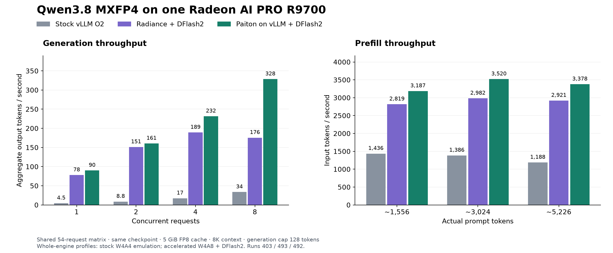
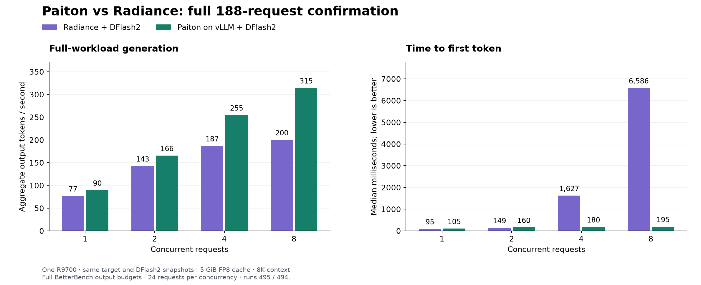

# Qwen3.8 27B on one R9700: history

Earlier results, release notes and comparisons, moved here from the [guide](README.md) and the
[release reference](REFERENCE.md) on 10 November 2026. Nothing on this page describes the current release unless it
says so; the current numbers are in the [guide](README.md#current-benchmark-results).

## 7 November 2026: the new 3-bit weights and image r2 against the 24 October release

**7 November: new 3-bit weights and a new image.** Run `git pull`, then the 3-bit [download](README.md#optional-the-3-bit-weights)
again (revision `aee42dfdb78e851462743120a575bf2d6f7b9882`) and `sha256sum -c SHA256SUMS`.

#### 3-bit weights: fewer agent loops

We retuned part of the 3-bit scales (the MLP gate and up scales of layers 32 to 63)
  on coding-agent conversations; the 3-bit codes, format and size are unchanged. On 80 random SWE-bench Verified tasks
  (mini-swe-agent, 250-step limit, one R9700, `--mode long-kv4` on the 5 October image, thinking off), against a fresh run of the 24 October
  weights on the same tasks:

  | | 24 October weights | 7 November weights | Paired test |
  | --- | ---: | ---: | --- |
  | Tasks solved | 41 | 49 | p 0.12: **not significant** on 80 tasks |
  | Tasks where the agent looped (the same command 3+ times in a row) | 16 | 7 | p 0.078: borderline |
  | Tasks stopped by the 250-step limit | 20 | 12 | p 0.13 |

  For scale: the 16-bit model solved 58 of the same 80 (served on a datacenter GPU). Agent runs at
  temperature 0.7 vary from run to run.

  **All 500 SWE-bench Verified tasks (8 November).** The same agent settings, `--mode long-kv4`, one R9700 per run:
  the 7 November weights on image r2, the 24 October weights on the 5 October image (the run of 3-5 November), and the
  16-bit model served on a datacenter GPU. One run each, paired per task with an exact McNemar test. The held-out 250
  are the second half of the task list; none of them was used to train the new weights.

  | | 16-bit model | 24 October weights | 7 November weights | 7 Nov vs 24 Oct | 7 Nov vs 16-bit |
  | --- | ---: | ---: | ---: | --- | --- |
  | Solved, all 500 | 390 | 284 | 323 | 81 vs 42 tasks solved by only one, p 0.0006 | 25 vs 92, p < 0.0001 |
  | Solved, held-out 250 | 191 | 134 | 165 | 48 vs 17, p 0.0002 | 17 vs 43, p 0.001 |
  | Looped, all 500 | 12 | 89 | 67 | p 0.03 | p < 0.0001 |
  | Stopped by the step limit, all 500 | 8 | 107 | 69 | p 0.0003 | |

  The new weights solve more tasks than the 24 October weights, and the difference is significant on all 500 and on the
  held-out 250. They loop less and hit the step limit less, also significantly. They still solve significantly fewer
  tasks than the 16-bit model, and loop on 67 tasks against its 12. The 80 tasks used to choose these weights lie inside
  the held-out 250; on the other 170 the new weights solved 110 against 95 (p 0.04). On the 197 tasks used for training,
  the two 3-bit weights are not significantly different (137 vs 145, p 0.26). The two 3-bit runs used different images,
  so the solved and loop counts compare the weights, while time and energy mix both changes.

  Task scores (one R9700, 65K mode, thinking on, the new weights on image r2; paired on the same questions):

  | | 16-bit model | 24 October weights, r1 | 7 November weights, r2 |
  | --- | ---: | ---: | ---: |
  | GSM8K (1,319) | 95.5 | 95.8 | 95.8 |
  | HumanEval (164) | 95.7 | 93.3 | 97.0 |
  | MMLU-Pro (1,400) | 81.5 | 79.3 | 79.5 |

  No change against the 24 October weights is significant (exact McNemar p 1.00 / 0.07 / 0.85). HumanEval moves
  between 92 and 97 from run to run with these weights, so read its +3.7 points as noise, not a gain. Against the 16-bit
  model the new weights are within noise on GSM8K and HumanEval and 2.0 points lower on MMLU-Pro (p 0.02). The 16-bit
  column was measured on a datacenter GPU with the same questions and seeds. Until 8 November this column showed the
  16-bit scores of Qwen3.8 Flash Next by mistake; it now shows Qwen3.8 27B.
#### Image r2: native kernels

The DFlash2 drafter's attention and heads and parts of the 3-bit model's GDN and gate
  paths now run on Paiton's own HIP kernels instead of Triton kernels. Each decode step is about 3.5 % cheaper and the
  drafter's acceptance is unchanged, so overall speed is about the same to slightly faster. The arithmetic is not
  bit-identical to r1, so a greedy answer can differ from r1's after some tokens.

  | One R9700 (300 W), `run-3bit.sh` (65K mode) | 5 October: r1 + 24 October weights | 7 November: r2 + new weights |
  | --- | ---: | ---: |
  | Decode, one request at a time, 32 prompts (tok/s) | 162.1 | 165.4 |
  | Decode, four requests, 32 prompts (tok/s, total) | 343.8 | 354.5 |
  | Time per decode step, one request (ms) | 28.65 | 27.66 (−3.5 %) |
  | Decode, eight requests, one prompt (tok/s, total) | 508.9 | 529.8 |
  | Prompt reading, 29K-token prompt (tok/s) | 3,991 | 4,031 |
  | First start until ready | 174 s | 178-182 s |

  The 32 prompts are chat, coding, GSM8K, HumanEval and MMLU-Pro requests (greedy, up to 512 tokens, natural stop).
  Per prompt, the one-request difference is within noise (p 0.49); the step-time drop is clear (p < 0.001). The MXFP4
  weights run on r2 at the same speed as on r1 (one prompt: 76.7 vs 77.2 tok/s, 2.2 % cheaper per step).

#### Fix: `prompt_logprobs` no longer stops the server

On the 5 October image a request with `prompt_logprobs` in a
  3-bit mode could end the server with an out-of-resources error. r2 computes those logprobs with the exact output head;
  decoding still uses the fast verify head.

Earlier 3-bit revisions stay downloadable: `383fa4b221a992fc2437500328056ef05355c8eb` (24 October),
`3ef7eb149ec0bd9a0f7927491bf30f53f54ced01` (12 October) and `7a2e3d702144f744c1c5a46eaa42c7a2309d5cf7` (first release).
The 3-bit task tables further down were measured with the first weights (`7a2e3d70`) unless a row says otherwise. Details:
the [model card](https://huggingface.co/EliovpAI/Qwen3.8-27B-W3Rot-INT3-Paiton-RDNA4) and the
[release notes](REFERENCE.md#release-notes-7-november-2026).

## Earlier release notes

<a id="release-notes-5-october-2026"></a>

### Release notes: 5 October 2026 (image r1)

The image `ghcr.io/eliovp/paiton-vllm-plugin:qwen38-rocm10-vllm029-20261005-r1` (`sha256:245c71d54f046f89b74dbfbd4c894003754561e55c9d215a8d3ce65364fb0f80`)
is the 4 October image with a faster start, native long-prompt attention and 4-bit decode kernels, images in the
coding mode and larger cache tiers. Weights, drafter and every mode's limits are unchanged. Update this repository to
get the launcher that selects it; `--dry-run` prints the full Docker command.

- **Faster, reproducible start.** The image carries a seeded compile cache and warms its kernels before it answers:
  `--mode long-kv4` reaches healthy in about 180 s on its first start and in about 120 s on later starts (3-bit, one
  R9700, measured on the same host). The 4 October image needs about 305 s on its first start (it ships no seed) and
  about 150 s with an already warm cache directory. The
  seed also holds the compiled kernels of our validation runs: a compile cache built from scratch compiles a few
  runtime kernels differently, and on the 4 October image (which ships no seed) a cold start can therefore answer a few
  prompts differently from our validated outputs. With this image the first start answers exactly as validated. The start-up log prints one
  `[paiton.cache]` line with what the seed covered.
- **Native kernels, same answers.** The long-prompt attention of `--mode long` and `--mode long-kv4` and the
  4-bit cache's decode kernels are Paiton's own. On the same host, outputs match the 4 October image at the default
  settings: greedy answers, GSM8K texts, 65K-mode answers and long prompts up to 258K tokens. One long coding-mode
  prompt's first token differs between hosts for both images (its compile cache decides a near tie); the paired
  check on long coding prompts shows no accuracy change. First token on a 258K-token prompt: 122.2 s instead of 126.0 s
  (65K: 18.9 instead of 19.7 s); decode speed unchanged within noise.
- **New: images in the coding mode.** `--mode long-kv4 --vision` adds image input to the long-context coding mode:
  555,128 cached tokens with images, 262,144 per request. Images up to 4K are read at full resolution; larger ones
  are downscaled. `--mode long-512k` stays text-only. See [Images and vision](REFERENCE.md#images-and-vision).
- **Known item:** with the FP8 KV cache (`--mode long --vision`) the model can misread single characters of tiny text
  (about 15 px) in 4K screenshots; the coding mode (`--mode long-kv4 --vision`) reads the same text exactly. Prefer the
  coding mode for screenshots of code.
- **`--vision` modes handle large images more steadily:** images up to 4K (3840 x 2160) are read at full resolution,
  larger ones are downscaled, and memory stays clear of the card's limit (first answer on a 4096² image about 4.6 s
  instead of about 12 s).
- **Cache tiers hold more.** With this image a cached token takes about 24 KB in the RAM or SSD tier (was about
  40 KB). `--extend-cache auto` therefore picks system memory on a 32 GB host (a tier of about 677K tokens; 48 GB
  about 917K, 64 GB about 1.27M; these sizes are computed from the bytes per token, only the 16 GB SSD restores were
  measured), and the SSD on 16 to 24 GB hosts, whose default 64 GiB cap holds about 2.8M tokens.
  The disk tier grows while the server runs; an over-full folder is removed at the next start, and
  `--wipe-disk-cache` clears it by hand. See [Cache tiers](REFERENCE.md#cache-tiers).
- **Includes the 6 October launcher update** (one GPU by default, the pinned-memory default, the VRAM check before a
  start, the small-RAM-tier warning).
- **Unchanged except the vision caps:** every mode's context, cache and request limits; the MXFP4 and 3-bit weights;
  `--host-cache-gib` and `--disk-cache-dir`.
- **Earlier images** stay runnable with `--image` and keep their behaviour; the 4 October image remains the
  reference for these outputs. See [Run an earlier release](README.md#run-an-earlier-release).

<a id="launcher-update-26-october-2026"></a>

### Launcher update: 26 October 2026 (launcher only)

`git pull` in your checkout gets a launcher update. The image (5 October r1), the weights and every mode's limits stay
the same.

- **Thinking off by default with the 3-bit weights.** `run-3bit.sh` now starts every mode, the 65,536-token rows
  included, with thinking off, the setting all published 3-bit rows were measured with. The MXFP4 65,536-token rows
  keep thinking on. `--thinking on` restores the previous default; each request can still set
  `"chat_template_kwargs":{"enable_thinking":true}`.

<a id="launcher-update-11-october-2026"></a>

### Launcher update: 11 October 2026 (launcher only)

`git pull` in your checkout gets a launcher update. The image (5 October r1), the weights and the MXFP4 rows stay the
same.

- **The FP8 output head in every 3-bit mode.** Every `run-3bit.sh` row now keeps the checkpoint's FP8 output head
  (1.19 GiB) instead of a bf16 copy of it (2.37 GiB), as `--mode long-kv4` has since 6 October. Both forms hold the
  same weights; only the kernel that applies them changes. `--mode long` gives the freed VRAM to its cache: it now holds
  **316,325 tokens** instead of 281,665. Measured against the bf16 head on the same host and image, fresh servers,
  BetterBench with the published rows' settings:

  | `run-3bit.sh --mode long` | bf16 head (before) | FP8 head (now) |
  | --- | ---: | ---: |
  | Weighted single-stream decode | 174.5 tok/s | 173.6 tok/s |
  | Aggregate output at 1 / 2 / 4 / 8 requests | 145.7 / 250.8 / 369.7 / 477.6 tok/s | 145.4 / 252.9 / 369.4 / 490.2 tok/s |
  | Time to first token p50 at 1 / 2 / 4 / 8 requests | 68 / 104 / 112 / 141 ms | 68 / 104 / 112 / 139 ms |
  | Prefill at 2K / 8K / 16K / 32K / 64K depth | 4,253 / 4,155 / 4,142 / 3,945 / 3,635 tok/s | 4,281 / 4,170 / 4,142 / 3,937 / 3,637 tok/s |
  | Needles found at 131K / 258K tokens | 4/4 / 3/4 | 4/4 / 4/4 |
  | Cache | 281,665 tokens | 316,325 tokens |

  The other 3-bit rows (`run-3bit.sh`, `run-3bit.sh --vision`, `--mode long --vision`, `--mode long-512k`) keep their
  cache sizes and gain 1.18 GiB of headroom; each started with its previous cache size and passed its smoke probes
  (greedy text, a short chat, two images with `--vision`). `--lm-head bf16` restores the previous head, cache and
  allocator cap (with `--host-pools userptr` in `--mode long-kv4` and `long-512k`, the start command is exactly the
  previous launcher's).
- **A lower allocator cap with the FP8 head.** The head's native code runs outside PyTorch and adds about 0.28 GiB
  there, so the start's kernel warm-up, which fills PyTorch's allocator up to its cap, peaked 0.28 GiB higher
  (31,975 MiB against 31,693 MiB in `--mode long`). Every 3-bit mode with the FP8 head now caps PyTorch at 94 % of the
  card instead of 95 %. Start peaks with the new launcher: `--mode long` 31,587 MiB (31,693 with the previous
  launcher), `--mode long-kv4` 31,407 MiB, `run-3bit.sh` 31,767 MiB, `run-3bit.sh --vision` 31,397 MiB,
  `--mode long --vision` 31,340 MiB, `--mode long-512k` 31,460 MiB. Under load `--mode long` peaked at 30,138 MiB and
  `--mode long-kv4` at 30,113 MiB; at eight requests they gave 493.3 and 486.7 tok/s, and both found 4 of 4 needles in
  a 258K-token prompt.
- **The pinned host tables as GTT memory.** The embedding table that `--mode long-kv4` and `--mode long-512k` keep in
  system RAM (and a RAM cache tier) is now allocated as driver-owned GTT memory (`HSA_USERPTR_FOR_PAGED_MEM=0`) when the
  GPU's GTT size holds it with 2 GiB to spare (the default GTT size is half the RAM: 16 GB hosts and up). ROCm's default
  user-pointer memory can be moved when the kernel compacts host memory, which pauses the GPU briefly under load (seen
  on the two-GPU Flash Next release). On this model and host both kinds measured the same: the same speed and greedy
  outputs, and no GPU pauses after the start with either. `--host-pools userptr` keeps ROCm's default; the start prints
  which one it uses.
- **`--capture-sizes wide` (opt-in).** Runs steps of up to 256 tokens (a new request's prompt next to running ones)
  as captured graphs instead of up to 64. Measured in `--mode long-kv4`: aggregate output at 1 / 2 / 4 / 8 requests
  143.3 / 254.5 / 366.2 / 487.5 against 143.4 / 254.4 / 359.5 / 486.7 tok/s, time to first token within 3 ms, a start
  1 s longer: no clear gain, so the default keeps the release sizes.
- **Download without `hf`.** The set-up steps also give the pinned downloads through the `huggingface_hub` Python
  package, for systems where `pip install --user` put `hf` in a folder the shell does not search.
- **Unchanged:** the image, the weights, the MXFP4 rows (their start commands are byte-identical) and every cache size
  except `--mode long`'s.

<a id="launcher-update-6-october-2026-evening"></a>

### Launcher update: 6 October 2026, evening (launcher only)

`git pull` in your checkout gets a launcher update; the image, weights and every other mode's limits are unchanged.

- **`--mode long-kv4` holds 628,877 tokens** (569,878 before): the coding mode now keeps the checkpoint's FP8 output head
  instead of a bf16 copy (`--lm-head fp8`, the default on the 5 October image and later) and gives the freed VRAM to
  the shared cache. Measured against the bf16 head on the same host: 131K-token NLL equal on every bucket, needles at
  131K and 258K found 4/4. Decode at long context: one request 120 tok/s at 120K tokens of context and 100 at 228K, eight requests 165 and 147 tok/s in total (bf16 head: 113 / 99 and 166 / 150; our decode load, a shared prompt the drafter predicts well). `--lm-head bf16` restores the previous head and
  budget.
- **Short questions are answered during a long read.** `--mode long-kv4` reads a long prompt in 2,048-token steps
  (`--long-prefill-threshold 2048`, the default now): a short request sent during a 64K read gets its first token in
  about 0.7 s instead of about 5.9 s, and the long read takes about 1 % longer. Paired against the previous
  setting: 131K NLL equal on every bucket, needles 4/4, GSM8K and HumanEval identical, the first tokens of a 20-turn
  coding session identical. `--long-prefill-threshold off` restores the previous read behaviour; together with
  `--lm-head bf16` the start command is exactly the previous launcher's.
- **`--mode long-kv4 --vision` gets the same FP8 head** (555,128 cached tokens with images, was 496,129; the 29-case
  image set, eight concurrent image requests and the repeated cold 4K reads passed with no cache evictions). The
  2,048-token read steps stay off with images: under them the 15 px code string of the 4K screenshot misread one
  character ('Kq7-' for 'kq7-'),
  so a long read with an image keeps its 4,096-token steps (`--long-prefill-threshold 2048` is still accepted).
- **Unchanged:** `--mode long`, `--mode long-512k`, `--mode 65k` and the MXFP4 rows keep their settings and outputs
  (their start commands are byte-identical).
- **`--extend-cache auto` with the larger pool:** it still picks system memory only where the RAM tier holds at least
  1.25 times the GPU pool (a tier only slightly larger than the pool serves almost nothing to a cycling working set; the
  SSD tier's 2.8M tokens catch it). On this image the choice per host size is unchanged: 16 and 24 GB hosts get the SSD
  tier, a 32 GB host a 15.5 GiB RAM tier with the embedding on the GPU, 48 GB and up a RAM tier with the embedding in
  system memory. `--extend-cache ram` or `disk` forces one.

<a id="launcher-update-6-october-2026"></a>

### Launcher update: 6 October 2026 (launcher only)

`git pull` in your checkout gets a launcher update; images, weights and every mode's limits are unchanged.

- **Fixed: `--mode long-kv4` kept the embedding table on the GPU on hosts whose kernel reports the default pinned-memory
  limit as 0** (`/sys/module/ttm/parameters/pages_limit`), so the cache held 451,879 instead of 569,878 tokens and
  `--extend-cache` / `--host-cache-gib` were refused there. The launcher now reads the kernel's default (half the RAM).
- **Fixed: `torch.OutOfMemoryError` at start when VRAM is already in use** (a display on the R9700, or a container that is
  still stopping). Before a real start the launcher reads the selected card's VRAM in use; above 1 GiB it waits up to 30 s
  for a stopping container, then refuses with the amount in use and the `--kv-cache-memory-bytes` that would fit.
  `--ignore-vram-check` skips the check; `--dry-run` never reads the card.
- **One GPU by default.** The server runs on exactly one R9700: the first qualified one, or `--devices N` (`--list-gpus`
  shows the numbers). Hosts with an integrated GPU no longer expose it to the container. A `HIP_VISIBLE_DEVICES` /
  `ROCR_VISIBLE_DEVICES` environment still applies as before.
- **Warning for a RAM tier smaller than the GPU cache** (`--extend-cache ram` or `--host-cache-gib` on a 16 to 24 GB host):
  such a tier keeps a copy of what the GPU already holds, so it rarely helps with several large documents in turn;
  `--extend-cache disk` keeps them across the session.
- **Unchanged:** outputs, modes and limits; `--dry-run` prints the same Docker command as before except for the three
  GPU-selection variables and, on hosts affected by the pinned-memory fix, the restored embedding placement and cache
  size.

<a id="release-notes-4-october-2026"></a>

### Release notes: 4 October 2026 (image r1)

The image `ghcr.io/eliovp/paiton-vllm-plugin:qwen38-rocm10-vllm029-20261004-r1` (`sha256:6a97d65fda17c1c48b36d3423c6f3709bd65a3849227e45a8a24a552d4c81b9d`)
is the 3 October image with one fix to the prefix-cache connector. Weights, drafter and the serving settings are
unchanged. Update this repository to get the launcher that selects it; `--dry-run` prints the full Docker command.

- **Fixed: the RAM and SSD cache tiers with the 4-bit cache.** With the 4-bit cache, a hit from system RAM or disk
  now always resumes on a recurrent-state block. That is why the 3 October image refused these tiers in
  `--mode long-kv4`. Every reopened document gives output bit-identical to the same document served from the GPU
  cache, at every length tested (32K to about 258K tokens). A hit the server cannot place is read again instead.
- **New, opt-in: `--extend-cache [auto|ram|disk]`** for `--mode long-kv4`. It keeps prefix-cache blocks that leave
  the GPU in system RAM or on an NVMe/SSD and sizes the tiers for the host. On a 16 GB host with a SATA SSD, after a
  full server restart, a 130K-token document came back in 6.8 s instead of 46.9 s cold, a 200K-token document in
  9.0 s instead of 86.4 s, both with the same output as a fresh read. See [Cache tiers](REFERENCE.md#cache-tiers).
- **Launcher: memory checks for the tiers.** On a 16 GB host it refuses a RAM tier with the embedding table in
  system RAM (that needs 32 GB) and moves the table to the GPU instead. With a tier it refuses to start when free
  memory is short, naming the shortfall, and warns when memory is tight. With a disk tier the container gets its own
  `/dev/shm`, so a crash never leaves the tier behind.
- **Unchanged:** without a cache tier, outputs are identical to the 3 October image. `--mode 65k`, `--mode long`,
  `--mode long-kv4`, `--mode long-512k`, `--vision` and the MXFP4 weights produce the same serving command as there;
  only the image differs. `--host-cache-gib` and `--disk-cache-dir` still work.
- **Earlier images** stay runnable with `--image` and keep their behaviour. The 3 October image and older refuse the
  4-bit cache tiers, whether given by tag or by digest; see
  [Run an earlier release](README.md#run-an-earlier-release).

<a id="release-notes-3-october-2026"></a>

### Release notes: 3 October 2026 (image r1)

The image `ghcr.io/eliovp/paiton-vllm-plugin:qwen38-rocm10-vllm029-20261003-r1` (`sha256:fb71b59eb29f3341dd10e9972920e75073a03fefc7bf6d2f2e1966b91a730f53`)
is the 2 October image (r1s) with the changes below. Weights, drafter and the other serving
settings are unchanged. Update this repository to get the launcher that selects it; `--dry-run` prints the full
Docker command.

- **`--mode long-kv4` is now the coding mode.** It adds prefix caching and keeps the input embedding table
  (2.4 GiB) in pinned system RAM, which gives the shared 4-bit cache 569,878 tokens instead of 458,922 (628,877 since
  the 6 October evening launcher update, with the FP8 output head): two
  full-length requests at once. A coding conversation growing to 253K tokens and three agents sharing a repository
  ran 6.1 and 5.9 times faster end to end. Decode is unchanged; reading a new long prompt is about 3 % slower (7 to 13 %
  for short prompts). Without pinnable system RAM it keeps the table on the GPU (451,879 tokens). See
  [Coding mode](REFERENCE.md#coding-mode).
- **New, experimental: `--mode long-512k`.** Up to 524,288 tokens per request with the model's official
  long-context scaling (applied to every request in this mode), prefix caching and a 594,290-token cache. Opt-in;
  see [524,288 tokens](REFERENCE.md#mode-long-512k).
- **Fixed: prefix-cache hits in the 4-bit long mode.** A request resumed from the cache could continue from the
  recurrent state of another block, which is why the 2 October image runs `--mode long-kv4` without prefix caching.
  A new question about a 258K-token document now gives the same output from the cache (2.7 s) as from a cold read
  (134 s).
- **Fixed, `--mode long-512k` only: the long-context scaling of the multimodal position encoding.** vLLM computed
  the scaling's correction range for four times the original context, so part of the rotary frequencies differed
  from the reference implementation. Only `--mode long-512k`, the one mode that applies this scaling, is
  affected.
- **New options:** `--no-system-memory-weights`; experimental `--system-memory-weights` in `--mode long`,
  `--host-cache-gib` and `--disk-cache-dir` (both `--mode long` only) and `--gdn-state`. See
  [System memory and experimental options](REFERENCE.md#system-memory-and-experimental-options).
- **Unchanged:** `--mode 65k`, `--mode long`, `--vision` and the MXFP4 weights produce the same serving command as
  on the 2 October image; only the image differs. `--context 262144 --kv-cache kv4` keeps the 2 October form of
  `--mode long-kv4` (no prefix caching, embedding table on the GPU).
- **Earlier images** stay runnable with `--image` and keep their behaviour; see
  [Run an earlier release](README.md#run-an-earlier-release).

<a id="release-notes-2-october-2026"></a>

### Release notes: 2 October 2026 (image r1)

The image `ghcr.io/eliovp/paiton-vllm-plugin:qwen38-rocm10-vllm029-20261002-r1`
(`sha256:82a24a1926bc01a134b106401390650b9e0ddb0aa8cf6a613ba3a615ce46b840`) is the 29 September r2 image with the
changes below. Weights, drafter and the other serving settings are unchanged. Its rebuild with the same runtime,
`qwen38-rocm10-vllm029-20261002-r1s` (`sha256:a1c1025052f84a009428709bfe7e9431281ab5d5c0f723a49d79eecafe519dad`), is
the reference to run with `--image` ([how](README.md#run-an-earlier-release)); `--dry-run` prints the full Docker
command.

- **New: `--mode 65k|long|long-kv4`.** One option per serving mode: `65k` (the default), `long` (the same as
  `--context 262144`: FP8 cache with prefix caching) and `long-kv4` (the same as `--context 262144 --kv-cache kv4`).
  Without `--context`, `--mode long` picks 200,000 tokens with the MXFP4 weights and 245,000 with `--vision`, the
  same as those `--context` values. The launcher refuses flags that contradict the chosen mode; the old flag
  spellings keep working and are checked the same way.
- **New: a 4-bit KV page format with its own attention decode,** used by the 65K mode with the 3-bit weights and by
  `--mode long-kv4`. One decode step of an attention layer takes 14 % less time than with the previous 4-bit kernel
  at 200K tokens and 12 % less at the 65K mode's eight-request shape; in the 65K mode its accuracy equals the FP8
  cache. See [4-bit KV cache](REFERENCE.md#more-context-capacity-4-bit-kv-cache).
- **New: `--mode long-kv4`,** the long-context mode (still up to 262,144 tokens per request) with a shared 4-bit
  cache of 458,922 tokens instead of 281,665 (1.63×), without prefix caching: every request re-reads its full
  prompt. See
  [the 4-bit cache in the long-context mode](REFERENCE.md#the-4-bit-cache-in-the-long-context-mode).
- **Fixed: the 65K mode with the 3-bit weights under eight concurrent requests.** On the 29 September image the
  memory allocator could grow past the card's free VRAM, and the driver then moved GPU memory to system RAM. The
  launcher now caps the allocator and the image leaves 1 GiB of VRAM unclaimed after warm-up (BetterBench:
  179.7 tok/s single-stream, 488.5 tok/s with eight requests, 48/48 requests completed at each concurrency level,
  peak 30.85 GiB).
- **On the 29 September r2 image** (`--image`), the 4-bit long-context mode is refused: `--mode long-kv4`, and
  `--kv-cache kv4` with `--profile chat` or with a `--context` above 65,536 (with or without
  `--prefix-caching off`). With an explicit `--profile release` or `desktop`, `--kv-cache kv4` stays limited to
  200,000 tokens there.

<a id="release-notes-28-september-2026"></a>

### Release notes: 28 September 2026 (image r2 of 29 September)

The image `ghcr.io/eliovp/paiton-vllm-plugin:qwen38-rocm10-vllm029-20260929-r2`
(`sha256:1195f31329966b3dc4e8e2d17327d339827b3d2b09165f9969b053a6fc2db045`) is the 26 September 65K image with the changes below. Weights, drafter and the
other serving settings are unchanged. Update this repository to get the launcher that selects it.

- **Fixed in r2 (29 September): DFlash2 draft head built from an uninitialised tensor.** The
  drafter has no `lm_head` of its own; the target's is shared in after the drafter's weights
  load. The int2 draft head decided at load time whether that tensor was still empty and, if
  the memory it got happened to hold old data, quantised garbage. Text stayed correct (the
  target is untouched), but DFlash2 then accepted 0% of its draft tokens and decode ran at
  about a fifth of the published speed. Our test machines always received zeroed memory and
  never showed it; a user on Unraid did, and reported it with the diagnosis. The draft head is
  now always built on first use from the real head. The 20, 24, 26 and 28 September (r1)
  images all carry the affected file; on them, run the container with
  `-e RADIANCE_FAST_DRAFT=0` (the stock bf16 draft head, about 10% slower decode than the int2
  head) or update.
- **New: one image for both modes.** `run-rocm10.sh` starts the 65K mode. A `--context` above 65,536, for
  example `--context 200000`, starts the long-context mode on the same image: one request, prefix caching
  and an 8 GiB FP8 KV cache (the settings of the earlier 200K `chat` profile). `run-rocm10-65k.sh` and
  `run-rocm10-200k.sh` still work; the 200K script now uses this image instead of the 18 September 200K
  image.
- **New: image input.** `--vision` serves the checkpoint's vision encoder in the 65K mode; see
  [Images and vision](REFERENCE.md#images-and-vision).
- **New: 4-bit KV cache** with the 3-bit weights in the 65K mode, on by default; see
  [4-bit KV cache](REFERENCE.md#more-context-capacity-4-bit-kv-cache). New launcher option `--kv-cache auto|kv4|fp8`.
- **Fixed: engine stop under concurrent load.** With three to five requests at once, and rarely with one
  very short prompt, the 26 September image could stop with
  `RuntimeError: Paiton GDN norm nonfinite/arithmetic error: 1`, and requests failed until a restart.
  Unused padding rows in some GPU steps held uninitialized memory, and a safety check in the
  recurrent-layer norm stopped the engine on them. The image now zeroes these rows: a soak test of 10,002
  such steps ran without errors, and outputs are unchanged.
- **If you stay on the 26 September image,** run its container with `-e RADIANCE_DYNAMIC_WIDTH=0`. In our
  runs this avoided more than 99% of these steps. The launcher does not pass it; `--dry-run` prints the full
  Docker command.
- **Unchanged:** prefill and single-request decode speed.


<a id="earlier-releases-and-comparisons"></a>

## Earlier releases and comparisons with earlier images

Moved from the quickstart on 7 October 2026; the quickstart keeps only current results.

<a id="run-an-earlier-release"></a>

### Run an earlier release

Add `--image` with the exact reference below to the command of your row. The weights stay the same; give each image
its own runtime cache folder. With an earlier reference, the launcher builds the Docker command of that release;
`--dry-run` prints it without starting anything. Copy the reference exactly, including `@sha256:`, so that
Docker runs exactly that image. The launcher recognises an earlier image by its tag (`…-20261005-r1`, `…-20261004-r1`, `…-20261003-r1`,
`…-20261002-r1s`, `…-20260929-r2`), with or without the digest and also under a local re-tag that keeps the tag,
and by its digest alone; an image under any other tag or an image ID counts as the current image.

```bash
# 5 October r1, the previous release: every row (drafter on Triton kernels; avoid prompt_logprobs with the 3-bit weights)
export PAITON_CACHE_DIR="$PWD/runtime-cache/qwen38-rocm10-20261005"
mkdir -p "$PAITON_CACHE_DIR"
bash models/Qwen3.8-MXFP4-DFlash2/run-3bit.sh --mode long-kv4 \
  --image ghcr.io/eliovp/paiton-vllm-plugin:qwen38-rocm10-vllm029-20261005-r1@sha256:245c71d54f046f89b74dbfbd4c894003754561e55c9d215a8d3ce65364fb0f80

# 4 October r1: every row except images in the coding mode (--mode long-kv4 --vision)
export PAITON_CACHE_DIR="$PWD/runtime-cache/qwen38-rocm10-20261004"
mkdir -p "$PAITON_CACHE_DIR"
bash models/Qwen3.8-MXFP4-DFlash2/run-3bit.sh --mode long-kv4 \
  --image ghcr.io/eliovp/paiton-vllm-plugin:qwen38-rocm10-vllm029-20261004-r1@sha256:6a97d65fda17c1c48b36d3423c6f3709bd65a3849227e45a8a24a552d4c81b9d

# 3 October r1: every row; refuses --extend-cache
export PAITON_CACHE_DIR="$PWD/runtime-cache/qwen38-rocm10-20261003"
mkdir -p "$PAITON_CACHE_DIR"
bash models/Qwen3.8-MXFP4-DFlash2/run-3bit.sh --mode long-kv4 \
  --image ghcr.io/eliovp/paiton-vllm-plugin:qwen38-rocm10-vllm029-20261003-r1@sha256:fb71b59eb29f3341dd10e9972920e75073a03fefc7bf6d2f2e1966b91a730f53

# 2 October (r1s): every row except --mode long-512k
export PAITON_CACHE_DIR="$PWD/runtime-cache/qwen38-rocm10-20261002"
mkdir -p "$PAITON_CACHE_DIR"
bash models/Qwen3.8-MXFP4-DFlash2/run-3bit.sh \
  --image ghcr.io/eliovp/paiton-vllm-plugin:qwen38-rocm10-vllm029-20261002-r1s@sha256:a1c1025052f84a009428709bfe7e9431281ab5d5c0f723a49d79eecafe519dad

# 29 September r2: the 65,536-token rows and --mode long, also with --vision
export PAITON_CACHE_DIR="$PWD/runtime-cache/qwen38-rocm10-20260929"
mkdir -p "$PAITON_CACHE_DIR"
bash models/Qwen3.8-MXFP4-DFlash2/run-mxfp4.sh \
  --image ghcr.io/eliovp/paiton-vllm-plugin:qwen38-rocm10-vllm029-20260929-r2@sha256:1195f31329966b3dc4e8e2d17327d339827b3d2b09165f9969b053a6fc2db045
```

To return to the current release, run `export PAITON_CACHE_DIR="$PWD/runtime-cache/qwen38-rocm10-20261107"` again
and drop `--image`.

The 3 October image runs every row as it was released. With the 4-bit cache it refuses the RAM and SSD cache tiers
(`--extend-cache`, and `--host-cache-gib` with `--mode long-kv4`): there a cache hit could resume from the wrong
recurrent state. `--host-cache-gib` with `--mode long` (FP8 cache) works there as before.

On the 2 October image, `--mode long-kv4` runs as it was released: no prefix caching, the embedding table on the
GPU, a 458,922-token cache. The 29 September image refuses `--mode long-kv4`; both refuse `--mode long-512k` and
`--host-cache-gib`.

Command lines from earlier releases still start the same server:

| Earlier command | Same as |
| --- | --- |
| `run-3bit.sh --context 262144` | `run-3bit.sh --mode long` |
| `run-3bit.sh --context 245000 --vision` | `run-3bit.sh --mode long --vision` |
| `run-mxfp4.sh --context 200000` | `run-mxfp4.sh --mode long` |
| `run-3bit.sh --context 262144 --kv-cache kv4` | the 2 October `--mode long-kv4`: no prefix caching, 458,922 tokens (the launcher prints a note) |
| `run-rocm10.sh` | `run-3bit.sh` when `PAITON_W3ROT_DIR` is set, `run-mxfp4.sh` otherwise |

<a id="mode-long-short-requests"></a>

### `--mode long` against `run-3bit.sh` on short requests (1 October)

Short requests in `--mode long` against `run-3bit.sh`, 1 October: the full 20-pass BetterBench, cold prefix cache,
fresh processes, the same tool and settings as the September tables.

| BetterBench row | `--mode long` | `run-3bit.sh` |
|---|---:|---:|
| Weighted single-stream decode | 174.3 tok/s | 178.9 tok/s |
| Gap between stream updates, p99 | 29.3 ms | 28.0 ms |
| Time to first token, p50 (short prompts) | 85 ms | 86 ms |
| Eight concurrent requests, aggregate output | 458.9 tok/s | 478.8 tok/s |
| Prefill at 47K input tokens (64K depth) | 3,549 tok/s | 3,481 tok/s |
| Prefill at 94K / 184K input tokens | 3,040 / 2,395 tok/s | – |

[Reports and numbers](benchmarks/2026-10-01-262k/README.md).

<a id="earlier-coding-mode-comparisons"></a>

### Coding mode against the 2 October image (3 October)

Measured 3 October against the same mode on the 2 October image, which ran without prefix caching and with the
embedding table on the GPU. 3-bit weights, thinking off. The cache sizes are those of the 3 October release; the
6 October launcher raised `--mode long-kv4` to 628,877 tokens (see the quickstart's [What you get](README.md#what-you-get)).

| Capacity | 2 October image | `--mode long-kv4` | `--mode long-512k` |
| --- | ---: | ---: | ---: |
| Tokens per request | 262,144 | 262,144 | 524,288 |
| Shared KV cache | 458,922 tokens | **569,878 tokens** | **594,290 tokens** |
| Full-length requests at once | 1, plus short ones | **2** (two 261K-token requests, none preempted) | 1, plus short ones |
| Prefix cache | no | yes | yes |
| Embedding table in system RAM | – | 2.4 GiB | 2.4 GiB |

BetterBench, the full 20-pass run with the same tool and settings as the tables above:

| BetterBench row | 2 October image | `--mode long-kv4` | `--mode long-512k` |
| --- | ---: | ---: | ---: |
| Weighted single-stream decode | 174.3 tok/s | 173.4 tok/s (−0.5 %) | 173.3 tok/s (−0.6 %) |
| Speculative acceptance length | 4.098 | 4.103 | 4.132 |
| Aggregate output at 1 / 2 / 4 / 8 requests | 144.5 / 247.3 / 364.6 / 462.4 tok/s | 143.9 / 246.2 / 355.4 / 478.5 tok/s | 144.6 / 247.5 / 360.7 / 463.5 tok/s |
| Time to first token p50 at 1 / 2 / 4 / 8 requests (short prompts) | 86.7 / 126.3 / 134.3 / 149.7 ms | 87.1 / 124.8 / 132.4 / 147.8 ms | 86.9 / 126.9 / 135.9 / 152.8 ms |
| Cold prefill at 2K / 8K / 16K / 32K / 64K depth | 4,167 / 4,165 / 4,102 / 3,954 / 3,633 tok/s | 3,641 / 3,856 / 3,769 / 3,824 / 3,536 tok/s | 3,638 / 3,846 / 3,959 / 3,829 / 3,541 tok/s |

With prefix caching the server stops each prefill step where a later request can resume from the cache. On long
prompts that costs about 3 % (32K to 64K); short prompts pay a fixed 7 to 13 % (a 2K-token prompt takes two steps
instead of one). Decode and short-prompt latency are unchanged.

What the prefix cache buys in coding workloads. Both columns ran on a pre-release build of these configurations,
before the release cut the number of prefill steps with prefix caching; the left column is the 2 October form of
the mode (no prefix caching, the embedding table on the GPU):

| Workload | 2 October form (no prefix caching) | `--mode long-kv4` | Faster |
| --- | ---: | ---: | ---: |
| One conversation growing from 50K to 253K tokens over 20 turns: whole session | 1,237 s | **204 s** | **6.1×** |
| … mean time to first token (turns 2 to 20) / at turn 20 | 63.6 s / 120.8 s | **7.8 s / 11.2 s** | 8–11× |
| Three agents sharing a 100K-token repository prefix, 5 turns each: whole session | 655 s | **111 s** | **5.9×** |
| … first reply of each agent | 33 / 68 / 101 s | **2.6–2.7 s** | up to 38× |
| … later turns, mean time to first token | 84 s | **7.0 s** | 12× |
| Prompt tokens served from the cache | 0 % | 91–92 % | |
| New question about a 258K-token document already read | cold read 134 s | **2.7 s** (the same output as a cold read) | 49× |

Accuracy with standard-length questions, greedy, paired per question:

| Benchmark | `run-mxfp4.sh` | 2 October image | `--mode long-kv4` | `--mode long-512k` |
| --- | ---: | ---: | ---: | ---: |
| GSM8K 5-shot (1,319) | 95.68 | 95.53 | 95.45 | 95.53 |
| HumanEval pass@1 (164) | 95.12 | 92.07 | 92.68 | 94.51 |
| MMLU-Pro subset, 0-shot (14 × 100) | 62.57 | 60.57 | 59.93 | 60.64 |
| Needle at 61,440 tokens (80) | 80/80 | 80/80 | 80/80 | 80/80 |
| Needles at 300K / 500K tokens (4 facts each) | – | – | – | 4/4 / 4/4 |

Each 3 October column is within noise of the column to its left (paired, p > 0.05 for every benchmark), and an
answer from the cache scores like a cold read (log-likelihood difference +0.008 nats per token, 95 % interval
−0.055 to +0.083; the same top token at 59 of 60 positions). The 3 October columns and this cache check ran on
pre-release builds of these configurations. The MMLU-Pro gap to MXFP4 is the 3-bit weights' own gap, as in the
65,536-token rows. Over five 131K-token documents the 4-bit cache predicts the text as well as the FP8 cache at
every depth (pre-release build).

`--mode long-512k`: reading a 300K-token document cold took 158 s, a 500K-token one 361 s; follow-up questions
took 2.8 to 2.9 s and 4.2 to 4.4 s with 297,600 and 497,600 tokens from the cache. Its weighted BetterBench decode
matches `--mode long-kv4`, but the chat category decoded 16 % slower than on the 2 October image (116.1 against
137.9 tok/s, one run).
[Coding mode details](REFERENCE.md#coding-mode) · [`--mode long-512k` details](REFERENCE.md#mode-long-512k).

## Historical releases and comparisons

The sections below describe earlier images, checkpoints, launchers and benchmark
settings. Their numbers are separate from the current release. In particular,
`serve.py`, `runtime.lock.json`, and `checkpoint.lock.json` below describe the
legacy release; use the [quickstart](README.md) for the current image.


## 26 September 2026 release: optional 3-bit W3A4 weights

The 26 September 65K image (`ghcr.io/eliovp/paiton-vllm-plugin:qwen38-rocm10-vllm029-65k-20260926-w3a4-r1`)
introduced the optional 3-bit W3A4 weights with the FP8 KV cache. Its throughput tables remain
[above](REFERENCE.md#current-benchmark-results) and in [benchmarks/2026-09-26-w3a4](benchmarks/2026-09-26-w3a4/README.md).
Under three to five concurrent requests it can stop the engine; see the
[28 September release notes](#release-notes-28-september-2026) for the fix and a workaround.

## 24 September 2026 release: faster prefill and opt-in n-gram co-drafting

The 24 September 65K image (`ghcr.io/eliovp/paiton-vllm-plugin:qwen38-rocm10-vllm029-65k-20260924-r3`)
prefilled 3,457–3,871 input tok/s from 2K to 64K (+3.5–5.4% over the 20 September image) and
measured 154.78 tok/s weighted decode and 422.9 tok/s aggregate at concurrency eight. On the 200K
chat profile, a 35-turn agentic coding session had 10–11% lower session time to first token. Its
full tables are in [benchmarks/2026-09-24-prefill-ngram](benchmarks/2026-09-24-prefill-ngram/README.md);
its opt-in n-gram co-drafting mode is described [above](REFERENCE.md#faster-agentic-coding-decode-n-gram-co-drafting-opt-in).

## 20 September 2026 release: ROCm 10 and vLLM 0.29 combined runtime

The 20 September 65K image (`ghcr.io/eliovp/paiton-vllm-plugin:qwen38-rocm10-vllm029-65k-20260920-r2`)
measured 154.42 tok/s weighted decode, 218.1 tok/s median JSON decode and 421.20 tok/s
aggregate at concurrency eight: +5.16% weighted decode and +4.37–5.61% large-prefill
throughput over the 18 September image. Its full tables, including the GGZ reference
columns, are in [benchmarks/2026-09-20-combined](benchmarks/2026-09-20-combined/README.md).

## Long coding conversations: prefix caching can remove most repeat-turn waiting

**New APC investigation, 17 September 2026.** Automatic prefix caching reuses
computation for an unchanged conversation prefix. It can make a large practical
difference when a coding agent sends the same growing history on every turn.
Our released profiles currently disable it because compact native GDN replay
does not yet support prefix reuse.

On one R9700, the stock-GDN APC path reduced **40K cold-to-repeat first-token
latency from 15.58 s to 1.13 s**. Our experimental native-prefill APC candidate
reduced **150K cold-to-repeat latency from 88.46 s to 2.04 s**, reproduced with a
second distinct prefix at **88.61 s to 2.03 s**. Those are **43–44× faster response
starts on cache hits**, not decode-throughput gains or new competitor results.
The 150K tests used an 8 GiB cache and one active request.

APC is a workload choice: it helps repeated documents and growing conversations,
while the compact native path retains better decode performance and cache
capacity for fresh prompts. The report includes these tradeoffs and the cache
miss, branch, tool-result and concurrency checks.

**Availability:** the existing GHCR images remain unchanged. They do **not**
implement the new `PAITON_PREFIX_CACHING=1` convenience flag yet. Users can try
the measured stock-GDN APC configuration on the published 64K image with the
[explicit profile override](benchmarks/2026-09-17-prefix-caching/REPRODUCE.md).
The native-prefill APC candidate is not yet distributed. Do not apply the
fallback to the 200K image with its existing 8 GiB cache: that budget does not
meet the stock-APC cache requirement at 200K.

[APC results, raw evidence and limitations](benchmarks/2026-09-17-prefix-caching/README.md)
· [Try stock-GDN APC and reproduce the controls](benchmarks/2026-09-17-prefix-caching/REPRODUCE.md).

## 64K and 200K images, tool-call fix, and quick benchmark (17 September 2026)

New v1.1.0 images add Qwen XML tool-call parsing and configurable context limits.
The **64K profile** uses a 5 GiB cache and up to eight scheduled requests; the
**200K profile** uses an 8 GiB cache and one active request, with little spare
VRAM on the 32 GB R9700. The original v1.0.0 image remains available.

The 64K image completed a 52-request BetterBench quick run: **304.1 tok/s aggregate
at concurrency eight**, with **67.8 tok/s median per request**. These are short
prompts with a 128-token output cap and thinking disabled. Separate long-context
retrieval and OpenCode tool tests are documented alongside the benchmark.

[New benchmark page, visuals, evidence, and GHCR package links](benchmarks/2026-09-17-agentic-64k/README.md)
· [64K and 200K launch commands](LAUNCH-agentic-v1.1.0.md)
· [Tool calling and context details](SUPPORT.md).

The comparison sections below retain the measurements from the earlier 8K release.

## Earlier release benchmark suites

Paiton delivers **22% higher weighted decode throughput**, **57% more throughput
at eight concurrent requests**, and **12.5–17.3% faster prefill** than Radiance +
DFlash2 on the same Radeon AI PRO R9700. Paiton leads all eight task categories
and all four concurrency throughput levels in the full 188-request comparison.

At eight concurrent requests, median time to first token falls from **6.59
seconds to 195 ms**, including queueing. The same 5 GiB cache pool provides
**2.89× the estimated token capacity**, with logs recording eight active requests
for Paiton versus three for Radiance.

Paiton combines native HIP kernels, adapted Radiance techniques, and vLLM's
DFlash2 support. The official vLLM installation stays in place: a model-specific
plugin supplies the native implementation. There is no separate Radiance engine
or DFlash package to install.



The common 54-request matrix includes stock vLLM O2: C8 throughput is
**33.7 / 175.6 / 328.5 tok/s** for stock / Radiance / Paiton respectively. Its
128-token generation cap differs from the longer full preset, reported
separately below.



[Complete three-engine tables, latency, and measurement scope](BENCHMARKS.md).
Radiance retains an approximately 10–11 ms TTFT advantage at one and two
concurrent requests; Paiton's latency advantage appears under concurrent load.

## Run the v1.0.0 benchmark release

[Context overrides, structured tool calls, and coding-agent setup](SUPPORT.md)
cover the reproduced parser mismatch and the local configuration workarounds.
The corrected 64K profile has functional API/client validation separate from the
historical benchmarks.

Release **v1.0.0** is available on GHCR. The launcher pins the qualified image
by digest in [runtime.lock.json](runtime.lock.json).

Use Linux x86-64, Docker, and one Radeon AI PRO R9700 with working AMD GPU device
access. The dedicated image includes the pinned official vLLM 0.28 ROCm runtime,
the Paiton adapter, and all qualified native libraries.

```bash
docker run -d --name paiton-qwen38-mxfp4 \
  --device /dev/kfd --device /dev/dri --group-add video --shm-size 2g \
  -p 127.0.0.1:8000:8000 \
  -v paiton-qwen38-mxfp4-cache:/models/cache \
  ghcr.io/eliovp/paiton-vllm-plugin@sha256:9b2dae214076d35de785e073b31294b033a376b16e6bc1ec1fdada4e54d96c59
```

The first image pull downloads approximately 11.4 GB of runtime layers when
those layers are not already cached. The first start then downloads approximately
21.9 GB of target and draft weights
from their original repositories and verifies the locked file hashes. Later
starts reuse the cache. Follow `docker logs -f paiton-qwen38-mxfp4` until startup
completes, then check `curl --fail http://127.0.0.1:8000/health`.

```bash
curl --fail http://127.0.0.1:8000/v1/chat/completions \
  -H 'Content-Type: application/json' \
  -d '{"model":"Qwen3.8-27B-Quark-AWQ-MXFP4","messages":[{"role":"user","content":"Write a Python function that preserves the first occurrence of each item in a list."}],"temperature":0,"max_tokens":256,"stream":true,"chat_template_kwargs":{"enable_thinking":false}}'
```

No compiler checkout or build step is required. The image starts the ordinary
vLLM OpenAI API server after checkpoint verification.

## Launcher and cached models

From this repository, [serve.py](serve.py) starts the same image and defaults to
verified downloads with a persistent Docker cache volume:

```bash
python3 models/Qwen3.8-MXFP4-DFlash2/serve.py --detach
```

Use `--cache /path/to/cache` for a host cache directory, `--port` for another
local port, and `--name` for a different container name. `--dry-run` prints the
Docker argument list without downloading files or starting a container.

To download and verify the snapshots without accessing the GPU:

```bash
python3 models/Qwen3.8-MXFP4-DFlash2/serve.py --download-only
```

After downloading, `--offline` requires cached or explicitly mounted files.
Existing snapshot directories can be supplied independently; each is mounted
read-only and verified inside the container:

```bash
python3 models/Qwen3.8-MXFP4-DFlash2/serve.py \
  --target /path/to/pinned-target-snapshot \
  --draft /path/to/pinned-draft-snapshot \
  --offline --detach
```

Use one launch example at a time for the same GPU. `docker stop
paiton-qwen38-mxfp4` stops the default serving container; the cache persists.

## Model and v1.0.0 profile

| Setting | Tested configuration |
|---|---|
| Target | `amd/Qwen3.8-27B-Quark-AWQ-MXFP4` |
| Draft | `tcclaviger/Qwen3.8-27B-DFlash2-FP8` |
| Hardware | One Radeon AI PRO R9700, RDNA 4 / `gfx1201`, 32 GB |
| Runtime | Official vLLM 0.28 ROCm image plus the Paiton plugin |
| Input | Text |
| Maximum context | 8,192 total tokens per request |
| Concurrent requests | Up to eight |
| Cache | FP8 KV, explicit 5 GiB pool, prefix caching disabled |
| Prefill chunk | Up to 4,096 tokens |
| Speculation | DFlash2, seven speculative tokens, unpadded drafting |
| Benchmark sampling | Greedy; no requested log probabilities |

Target and draft revisions, file sizes, and SHA256 hashes are pinned in
[checkpoint.lock.json](checkpoint.lock.json). This checkpoint is distinct from
the Qronos and NEO CODER MAX releases; their speeds are not used as model-matched
baselines here. The token-cache capacity estimate does not extend the tested
8,192-token per-request context limit.

The native overlay and manifests are also distributed through
[Hugging Face](https://huggingface.co/EliovpAI/Qwen3.8-27B-Quark-AWQ-MXFP4-DFlash2-Paiton-RDNA4).
The weight files remain in the original model repositories.

## Integration and provenance

The dedicated image installs the model-specific plugin with `--no-deps` onto
the pinned official vLLM image. It uses vLLM's extension interfaces for the
model, loader, linear kernels, attention backend, and worker. It does not replace
the installed vLLM library. The main repository's general installation has a
different historical vLLM pin; use this model's qualified image and profile.

Paiton's native artifacts use HIP and load independently of PyTorch, Triton,
and Radiance. The serving adapter retains vLLM's existing framework dependencies
and upstream DFlash2 scheduling. The compiler and implementation source stay
private; the runtime package contains only the external adapter, allowlisted
native libraries, and runtime metadata.

[Radiance](https://github.com/magiccodingman/vllm-radiance) and
[StillDeadcode/libr4d](https://codeberg.org/StillDeadcode/libr4d) are credited for
the adapted kernel techniques. [Third-party attribution and terms](THIRD_PARTY_NOTICES.md).

The ordinary CLI deployment check passes streaming, eight concurrent requests,
and generation at the 8K context boundary followed by a fresh request.
[Deployment check](deployment-check.json) · [Unchanged-vLLM audit](runtime-audit.json) · [Published-image audit](release-audit.json).

## Reproduce the image context

The image can be rebuilt from the public adapter and the pinned native overlay.
The context preparer verifies an explicit file allowlist; it does not require
the private compiler. Download the companion release with the Hugging Face CLI,
then prepare a new build directory:

```bash
hf download EliovpAI/Qwen3.8-27B-Quark-AWQ-MXFP4-DFlash2-Paiton-RDNA4 \
  --revision v1.0.0 --local-dir qwen38-paiton-runtime
python3 models/Qwen3.8-MXFP4-DFlash2/prepare_image_context.py \
  --overlay qwen38-paiton-runtime/overlay --output qwen38-image-context
docker build -t paiton-qwen38-mxfp4:local qwen38-image-context
```

Use this model's `runtime-pyproject.toml`, copied automatically by the preparer;
the repository-wide package targets other runtime versions. The published
container digest identifies the tested distribution; a local rebuild creates
its own image identity.
